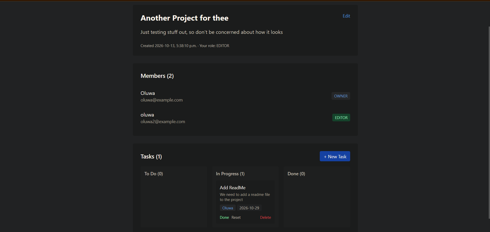
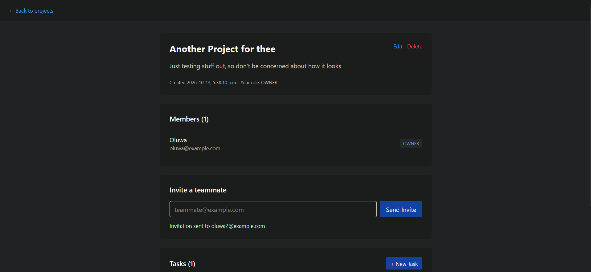

# DevBoard — Frontend

The React frontend for DevBoard, a collaborative project tracker.

**Live demo:** https://devboard-ui.vercel.app  
**Backend repo:** https://github.com/Bamijoko-Seyi/devboard

---

## Features

- JWT authentication (login, register)
- Project dashboard with create, edit, delete
- Project detail with member list and roles
- Invite teammates by email
- Pending invitations page with accept/decline
- Kanban task board (Todo / In Progress / Done)
- Task assignment and due dates
- Responsive, minimal design (Tailwind CSS)

## Tech Stack

| Layer | Choice |
|---|---|
| Framework | React 19 + Vite |
| Routing | React Router |
| HTTP | Axios (with auth interceptor) |
| Styling | Tailwind CSS v4 |
| Notifications | react-hot-toast |
| Hosting | Vercel |

## Running Locally

**Prerequisites:** Node.js 20+, and a running backend (see the [backend repo](https://github.com/Bamijoko-Seyi/devboard)).

```bash
npm install
npm run dev
```

Runs on http://localhost:5173. Expects the backend at http://localhost:8080 by default.

To point at a deployed backend instead, create a `.env` file:

```env
VITE_API_URL=https://devboard-6i7g.onrender.com
```

Then restart the dev server.

## Environment Variables

| Variable | Description | Default |
|---|---|---|
| `VITE_API_URL` | Backend base URL | `http://localhost:8080` |

## Testing

```bash
npm test
```

Uses Vitest + React Testing Library.

## Project Structure

```
src/
├── api/           Axios client and endpoint wrappers
├── components/    Reusable UI pieces (TaskBoard, Skeleton, etc.)
├── context/       AuthContext (user session state)
├── pages/         Route-level components
└── test/          Test setup
```

## Auth Flow

1. On login, the JWT is stored in `localStorage`.
2. The axios client attaches it as `Authorization: Bearer <token>` on every request.
3. On 401, the token is cleared and the user is redirected to `/login`.
4. On app mount, `AuthContext` checks localStorage and validates the token by fetching `/api/auth/me`.

## Build for Production

```bash
npm run build
```

Output goes to `dist/`.

## Deploying to Vercel

The project is configured for Vercel with a `vercel.json` that rewrites all routes to `index.html`, enabling client-side routing on refresh.

Required environment variable in Vercel: `VITE_API_URL`.

Note: Vite bakes environment variables into the build at build time. After changing `VITE_API_URL` in Vercel, you must redeploy for the new value to take effect.

## Screenshots






## License

MIT License

Copyright (c) 2026 Oluwaseyifunmi Bamijoko

Permission is hereby granted, free of charge, to any person obtaining a copy
of this software and associated documentation files (the "Software"), to deal
in the Software without restriction, including without limitation the rights
to use, copy, modify, merge, publish, distribute, sublicense, and/or sell
copies of the Software, and to permit persons to whom the Software is
furnished to do so, subject to the following conditions:

The above copyright notice and this permission notice shall be included in all
copies or substantial portions of the Software.

THE SOFTWARE IS PROVIDED "AS IS", WITHOUT WARRANTY OF ANY KIND, EXPRESS OR
IMPLIED, INCLUDING BUT NOT LIMITED TO THE WARRANTIES OF MERCHANTABILITY,
FITNESS FOR A PARTICULAR PURPOSE AND NONINFRINGEMENT. IN NO EVENT SHALL THE
AUTHORS OR COPYRIGHT HOLDERS BE LIABLE FOR ANY CLAIM, DAMAGES OR OTHER
LIABILITY, WHETHER IN AN ACTION OF CONTRACT, TORT OR OTHERWISE, ARISING FROM,
OUT OF OR IN CONNECTION WITH THE SOFTWARE OR THE USE OR OTHER DEALINGS IN THE
SOFTWARE.